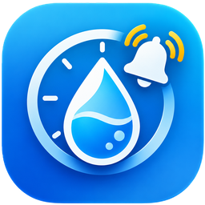
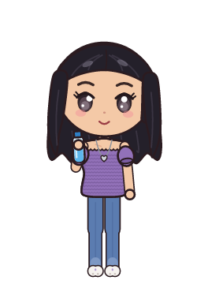
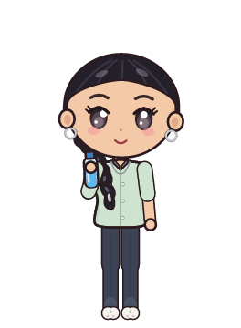
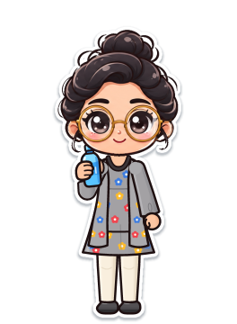
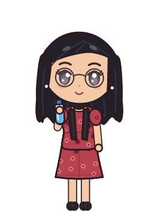
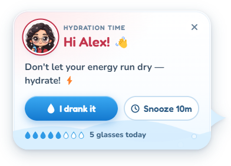
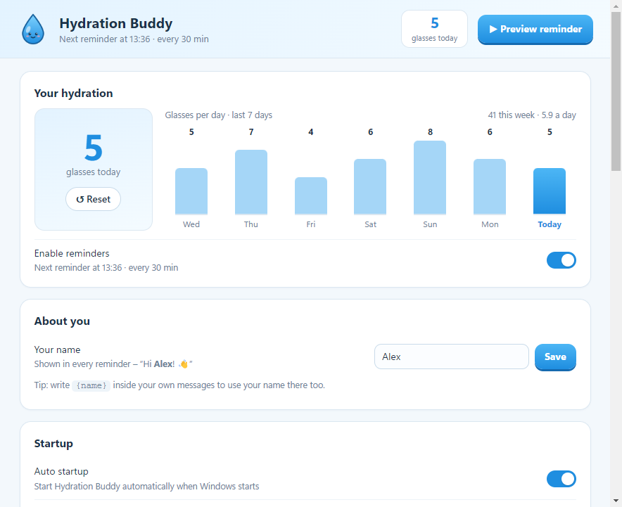
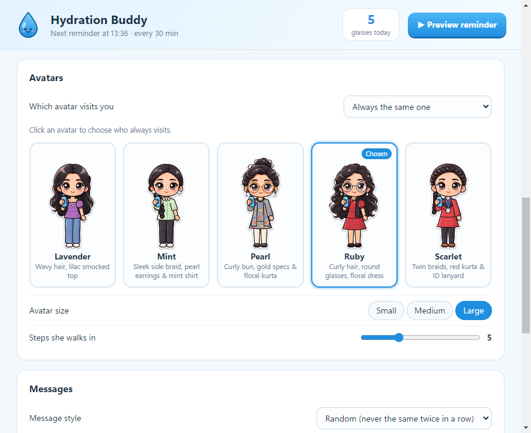
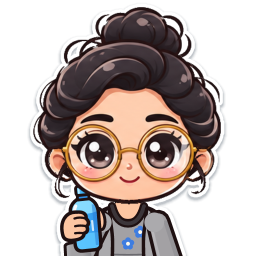
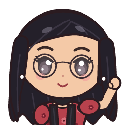

<div align="center">



# Hydration Buddy

**A friendly little character walks onto your screen and reminds you to drink water.**

[](https://github.com/Sabariks092/hyderation-buddy/raw/main/releases/Hydration%20Buddy%20Setup%201.3.0.exe)


<br>







</div>

---

## 💧 What it does

Hydration Buddy lives quietly in your system tray. When it is time for water, one of five animated
characters walks in from the edge of your screen, waves, and shows a friendly message. Click
**I drank it**, snooze, or dismiss, and they walk away again.

<div align="center">

</div>

## ✨ Features

| | |
|---|---|
| 🚶‍♀️ **Walking avatars** | Five hand-drawn characters with smooth walk, turn, wave and idle animations |
| 📊 **Hydration dashboard** | A 7-day chart of your glasses per day, today's total, weekly total and daily average |
| ⏰ **Flexible schedule** | Remind every 1 to 480 minutes, with one-click presets from 15 minutes to 2 hours |
| 🌙 **Quiet hours** | No reminders during the hours you choose, or while your PC is locked |
| 💬 **Your own messages** | 30 built-in messages plus any you write yourself, with `{name}` for your name |
| 🎭 **Pick your buddy** | A surprise each time, take turns in order, or always the same character |
| 😴 **Snooze and pause** | Snooze a reminder for a few minutes or pause everything for an hour from the tray |
| 🚀 **Starts with Windows** | Launches silently in the tray and begins reminding straight away |
| 🔒 **Private** | Everything stays on your PC. No account, no internet connection, no tracking |

## 📸 Screenshots

<div align="center">

**Dashboard: your week at a glance**



<br><br>

**Choose who visits you**



</div>

## 📥 Install

1. **`Hydration Buddy Setup 1.3.0.exe`** - [Download Hyderation Buddy](https://github.com/Sabariks092/hyderation-buddy/raw/main/releases/Hydration%20Buddy%20Setup%201.3.0.exe).
2. Run the installer and follow the steps.
3. Your buddy greets you a few seconds after the first launch. After that, look for the Hydration Buddy icon in the system tray.

> **Windows SmartScreen:** the installer is not code-signed, so Windows may show a "Windows protected your PC"
> notice. Choose **More info → Run anyway**.

## 🎮 Using it

- **Tray icon, left click:** open settings and the dashboard.
- **Tray icon, right click:** remind me now, log a glass, pause for an hour, turn reminders on or off, quit.
- **Reminder bubble:** *I drank it* adds a glass to today's count, *Snooze* brings your buddy back later, *✕* dismisses.
- **Dashboard:** the *Reset* button sets today's count back to zero. Earlier days are kept.

## 🧑‍🤝‍🧑 Meet the buddies

| Lavender | Mint | Pearl | Ruby | Scarlet |
|:---:|:---:|:---:|:---:|:---:|
|  |  |  |  |  |
| Wavy hair, lilac smocked top | Sleek side braid, pearl earrings and mint shirt | Curly bun, gold specs and floral kurta | Curly hair, round glasses, floral dress | Twin braids, red kurta and ID lanyard |

## 🛠️ Build from source

Requires [Node.js](https://nodejs.org) 18 or newer on Windows.

```bash
git clone https://github.com/Sabariks092/hyderation-buddy.git
cd hyderation-buddy
npm install

npm start          # run the app in development
npm run dist       # regenerate the artwork and build the installer into dist/
```

| Command | What it does |
|---|---|
| `npm start` | Runs the app with Electron |
| `npm run generate` | Renders every sprite sheet and icon, then packs the sprites |
| `npm run sprites` | Only re-packs the existing sprite sheets into animated AVIF |
| `npm run check:sprites` | Compares the packed sprites with their PNG sources |
| `npm run dist` | Builds `dist/Hydration Buddy Setup <version>.exe` |

### Project layout

```
src/
  main.js          main process: scheduling, tray, windows
  store.js         settings and drinking history (JSON in the user's app-data folder)
  sprites.js       unpacks the animated AVIF sprites into sprite sheets
  overlay/         the transparent window the avatar walks in
  bubble/          the clickable message bubble
  settings/        settings window and dashboard
  assets/generated generated artwork
scripts/
  generate-assets.js   renders the characters and their animations
  to-avif.js           packs sprite sheets into small animated AVIF files
```

### How the installer stays small

The animations are 273 frames per character. Stored as PNG sprite sheets they take 62 MB. Packed as
animated AVIF, where each frame is compressed against the one before it, they take about 5 MB, and
the app unpacks them back into sprite sheets in a fraction of a second when a reminder starts.

## 📄 License

MIT. The bundled fonts, Fredoka and Nunito, are under the SIL Open Font License (see `src/assets/fonts`).

<div align="center">
<br>
<b>Stay hydrated. 💙</b>
</div>
